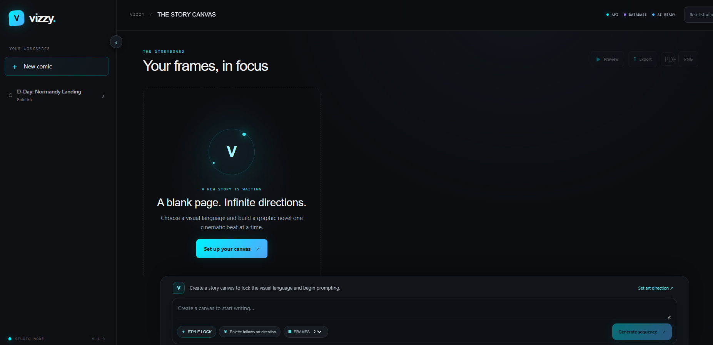

# Vizzy

Vizzy is a chat-first graphic novel and storyboard studio. Set a visual direction, palette, and story context, then build a sequence of illustrated frames collaboratively. Preview the sequence as a looping slideshow and export JSON, PNGs, or print-ready pages.



## Features

- Locked visual styles, palette notes, and character continuity anchors
- 3–6 ordered story frames generated from one brief
- Gemini image generation with a 16:9 composition and saved image assets
- Optional Pollinations FLUX fallback for Gemini outages or quota errors
- Storyboard canvas, chat history, slideshow controls, and exports
- Express API with Mongoose persistence and standardized JSON responses

## Requirements

- Node.js 20 or newer
- MongoDB, local or hosted
- A Gemini API key with image generation access for artwork
- An optional Pollinations server API key for image fallback
- An optional Gemini text API key for AI-assisted story breakdowns

## Run locally

From the repository root:

```sh
npm install
```

Copy `.env.example` to `backend/.env`, then set the provider credentials and MongoDB connection string. On Windows PowerShell:

```powershell
Copy-Item .env.example backend/.env
```

Start both services:

```sh
npm run dev
```

Open <http://localhost:5173>. The API listens on port `4000` by default; the Vite dev server proxies `/api`, `/health`, and `/generated` to it.

## Environment variables

| Variable | Required | Purpose |
| --- | --- | --- |
| `PORT` | No | Express port; defaults to `4000`. |
| `MONGODB_URI` | For local MongoDB setup | MongoDB connection string. Defaults to `mongodb://127.0.0.1:27017/vizzy_db`. Add `?authSource=admin` when the MongoDB user is stored in `admin`. |
| `AI_API_KEY` | No | Gemini API key for story breakdown and dialogue. Without it, Vizzy can still create a direct sequence from the prompt. |
| `AI_BASE_URL` | No | OpenAI-compatible text endpoint; defaults to Gemini's API endpoint. |
| `AI_MODEL` | No | Text model; the example uses `gemini-2.5-flash`. |
| `GEMINI_API_KEY` | For Gemini artwork | Server-side key for Gemini image generation. The key's Google project must have image-generation access and quota. |
| `GEMINI_IMAGE_MODEL` | No | Image model override; defaults to `gemini-3.1-flash-image`. |
| `POLLINATIONS_API_KEY` | Optional fallback | Pollinations server key. Required for the Flux fallback; this is a separate credential from `GEMINI_API_KEY`. |

Keep real credentials in `backend/.env`. Never add them to frontend variables or commit local `.env` files. `.env.example` files contain placeholders only.

## Image provider behavior

Artwork generation uses `GEMINI_API_KEY` first, requests a 16:9 image, validates the returned bytes, and saves the image under `backend/generated/`. If Gemini fails, Vizzy tries the current Pollinations Flux endpoint using `POLLINATIONS_API_KEY`. If neither provider is available, the API returns a structured error instead of fabricating placeholder artwork.

Image generation depends on provider access, quota, and billing eligibility. Gemini text generation's free allowance does not imply free image generation. Google's [current pricing](https://ai.google.dev/gemini-api/docs/pricing) lists no free-tier access for Gemini image-generation models; a production key must have an eligible project and active quota. Pollinations also requires its own authenticated server key. Changing keys alone cannot grant a model quota the provider has not enabled.

The image model default is `gemini-3.1-flash-image`. Override it with `GEMINI_IMAGE_MODEL` only when the configured provider supports that model. Gemini 2.5 Flash Image is retired; do not configure it for new deployments.

## API overview

Successful responses use `{ "success": true, "data": ... }`. Errors use `{ "success": false, "error": { "message": "...", "code": "..." } }`.

| Method | Path | Purpose |
| --- | --- | --- |
| `GET` | `/health` | API and database health |
| `GET`, `POST` | `/api/projects` | List or create projects |
| `DELETE` | `/api/projects/reset-all` | Delete projects, panels, chat history, and generated image cache |
| `GET`, `PATCH` | `/api/projects/:id` | Read or update project context |
| `POST` | `/api/projects/:id/generate` | Generate an ordered sequence from `{ brief, panelCount }` |
| `POST` | `/api/projects/:id/panels/reorder` | Reorder storyboard frames |
| `GET`, `POST`, `PATCH`, `DELETE` | `/api/panels`, `/api/panels/:id` | Manage panels |
| `GET` | `/api/chat-histories?projectId=<id>` | Read project conversation history |
| `GET` | `/api/options` | List supported visual styles |

## Verification

```sh
npm test
npm run build
```

## Scripts

- `npm run dev` — start the API and frontend in development mode
- `npm run build` — build the frontend for production
- `npm test` — run backend API, provider, model, and startup tests
